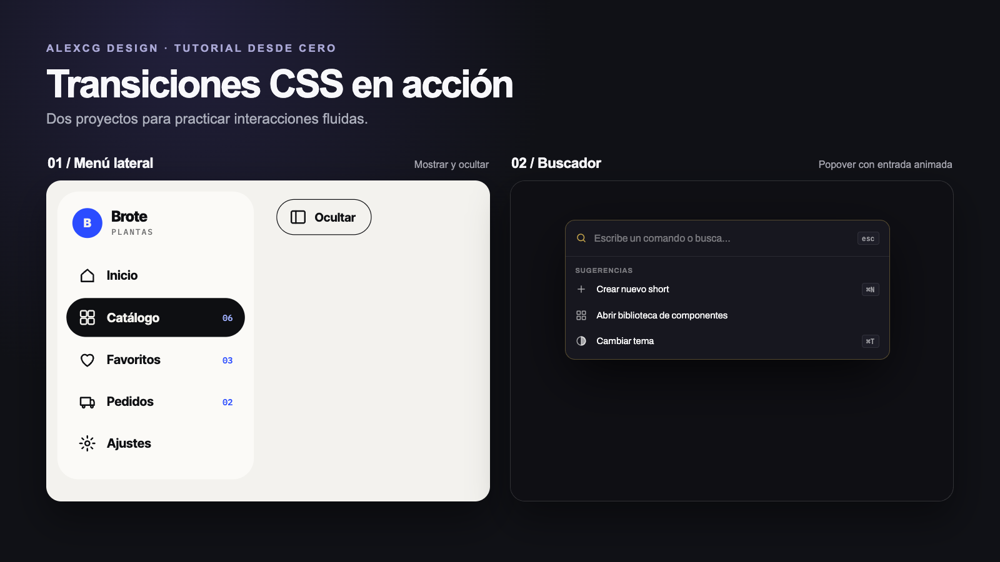

# Proyectos de transiciones CSS

Estos proyectos forman parte del [tutorial desde cero de AlexCG Design](https://youtu.be/aI_JPJAVXvk). En ellos se practican transiciones CSS aplicadas a dos interfaces interactivas.

## Proyectos

- [Menú lateral «Brote»](proyecto-uno/): muestra y oculta la barra lateral con una transición.
- [Buscador con popover](proyecto-dos/): abre una paleta de búsqueda con una transición de entrada.

Abre el archivo `index.html` de cada carpeta en un navegador para probar los ejemplos.
